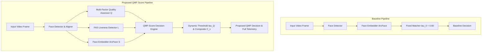

# Research Architecture & Implementation Mapping Specification

**Document Identifier:** `docs/Architecture/qmf_implementation.md`  
**Version:** 1.0.0  
**Date:** August 2026  
**Author:** Lead Software Architect & Research Engineer  

---

## 1. System Architecture Overview

To strictly satisfy experimental rigor and reproducible academic evaluation, the software architecture maintains **two completely independent, uncoupled recognition pipelines**:



---

## 2. Software Module Mapping to Research Formulas

| Research Formula in `research_methodology.md` | Software Class & Method | File Path |
| :--- | :--- | :--- |
| $\tau(Q_{sample}) = \tau_{base} + \lambda \cdot (1.0 - Q_{sample})$ | `QMFScoreEngine.compute_dynamic_threshold()` | [`backend/app/cv/research/qmf_engine.py`](file:///d:/Facial%20Recognition/backend/app/cv/research/qmf_engine.py) |
| $C(x) = \alpha S + \beta Q + \gamma L$ | `QMFScoreEngine.compute_composite_score()` | [`backend/app/cv/research/qmf_engine.py`](file:///d:/Facial%20Recognition/backend/app/cv/research/qmf_engine.py) |
| Multi-Stage Decision Gate Protocol | `QMFScoreEngine.evaluate_decision()` | [`backend/app/cv/research/qmf_engine.py`](file:///d:/Facial%20Recognition/backend/app/cv/research/qmf_engine.py) |
| Telemetry Record Persistence | `TelemetryRecord` | [`backend/app/cv/research/config.py`](file:///d:/Facial%20Recognition/backend/app/cv/research/config.py) |
| Baseline Benchmark Pipeline | `BaselinePipeline` | [`backend/app/cv/research/baseline_pipeline.py`](file:///d:/Facial%20Recognition/backend/app/cv/research/baseline_pipeline.py) |
| Proposed QMF Benchmark Pipeline | `ProposedQMFPipeline` | [`backend/app/cv/research/proposed_pipeline.py`](file:///d:/Facial%20Recognition/backend/app/cv/research/proposed_pipeline.py) |

---

## 3. Telemetry Schema

Every prediction generated by both pipelines records an immutable `TelemetryRecord`:

```json
{
  "prediction_id": "QMF-PRED-A1B2C3D4E5",
  "pipeline_type": "PROPOSED_QMF",
  "similarity_score": 0.884,
  "quality_score": 0.821,
  "liveness_score": 0.965,
  "composite_score": 0.865,
  "dynamic_threshold": 0.576,
  "final_decision": "AUTHENTICATED",
  "matched_student_id": "STU-2026-001",
  "threshold_parameters": {
    "tau_base": 0.55,
    "lambda_param": 0.15,
    "tau_quality_min": 0.30,
    "tau_liveness_min": 0.50,
    "tau_composite_min": 0.55
  },
  "model_version": "v2.0.0-QMF",
  "experimental_config": {
    "alpha_weight": 0.50,
    "beta_weight": 0.30,
    "gamma_weight": 0.20
  },
  "timestamp": "2026-08-13T12:38:54Z"
}
```

---

## 4. Verification Suite

The research implementation is verified by 5 dedicated integration tests in [`backend/tests/test_research_pipelines.py`](file:///d:/Facial%20Recognition/backend/tests/test_research_pipelines.py):
1. `test_qmf_engine_dynamic_threshold`: Validates linear adaptation bounds $\tau(1.0) = 0.55$ and $\tau(0.0) = 0.70$.
2. `test_qmf_engine_composite_score`: Validates weighted linear combination $C(x) = 0.5S + 0.3Q + 0.2L$.
3. `test_qmf_engine_gate_decisions`: Validates hard spoof and quality gate rejections vs authentications.
4. `test_baseline_vs_proposed_side_by_side`: Validates side-by-side execution on identical image inputs.
5. `test_telemetry_recording_completeness`: Validates presence of all 12 mandatory telemetry fields.
