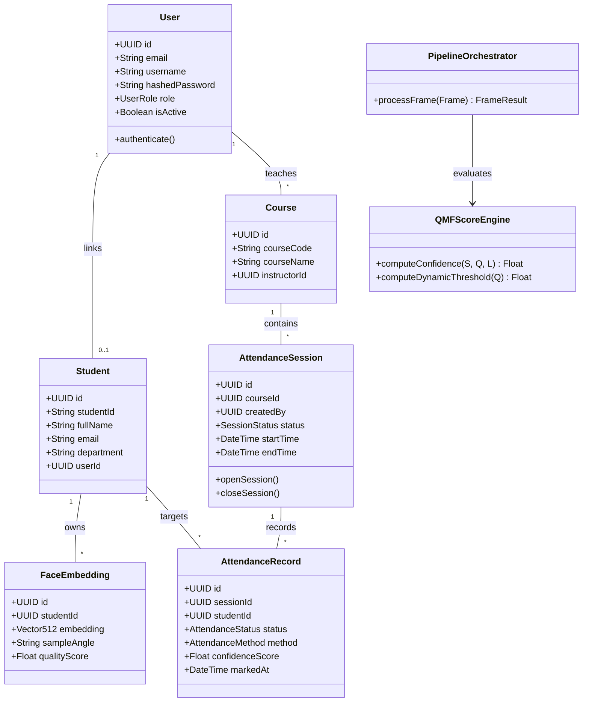
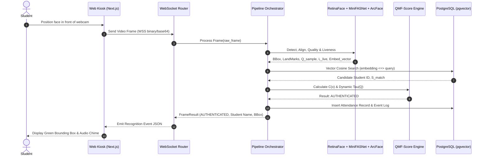
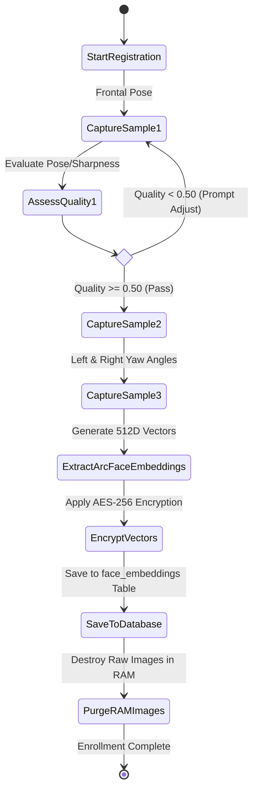

# Unified Modeling Language (UML) Diagrams

**Document Identifier:** `docs/UML/uml_diagrams.md`  
**Version:** 1.0.0  
**Date:** August 2026  
**Author:** Lead Software Architect & Research Engineer  

---

## 1. Use Case Diagram

```mermaid
graph TD
    subgraph Users
        Admin["Administrator"]
        Teacher["Instructor / Teacher"]
        Student["Student"]
    end

    subgraph "Facial Recognition Attendance System"
        UC1["Login & Authenticate"]
        UC2["Manage Users & Roles"]
        UC3["Manage Student Profiles"]
        UC4["Enroll Facial Biometrics"]
        UC5["Manage Courses & Rosters"]
        UC6["Create & Manage Attendance Sessions"]
        UC7["Run Kiosk Attendance Recognition"]
        UC8["Manual Attendance Override"]
        UC9["View Attendance Reports & Export"]
        UC10["View Personal Attendance History"]
        UC11["View System Security Audit Logs"]
    end

    Admin --> UC1
    Admin --> UC2
    Admin --> UC3
    Admin --> UC5
    Admin --> UC9
    Admin --> UC11

    Teacher --> UC1
    Teacher --> UC3
    Teacher --> UC4
    Teacher --> UC5
    Teacher --> UC6
    Teacher --> UC7
    Teacher --> UC8
    Teacher --> UC9

    Student --> UC1
    Student --> UC4
    Student --> UC10
```



---

## 2. Class Diagram (ORM Models & Business Services)



---

## 3. Sequence Diagram (Real-Time Video Recognition & Attendance)



---

## 4. Activity Diagram (Student Biometric Registration Flow)



---

## 5. Component Diagram (System Module Architecture)

```mermaid
componentDiagram
    package "Client Tier" {
        [Webcam Capture Module]
        [Kiosk Overlay Component]
        [Admin Dashboard UI]
    }

    package "API Server Tier (FastAPI)" {
        [REST Router Controllers]
        [WebSocket Stream Handler]
        [JWT Security & Auth Middleware]
        [Business Services Layer]
    }

    package "AI Computer Vision Core" {
        [RetinaFace Detector]
        [Quality Assessor Module]
        [MiniFASNet Liveness Module]
        [ArcFace Vector Embedder]
        [QMF-Score Decision Engine]
    }

    package "Data Layer" {
        database "PostgreSQL 16\n(pgvector)" as DB
        database "Redis Cache" as Cache
    }

    [Webcam Capture Module] --> [WebSocket Stream Handler]
    [Admin Dashboard UI] --> [REST Router Controllers]
    [WebSocket Stream Handler] --> [AI Computer Vision Core]
    [AI Computer Vision Core] --> [QMF-Score Decision Engine]
    [QMF-Score Decision Engine] --> DB
    [REST Router Controllers] --> [Business Services Layer]
    [Business Services Layer] --> DB
    [JWT Security & Auth Middleware] --> Cache
```

---

## 6. Deployment Diagram

```mermaid
graph TD
    subgraph Client Hardware
        WebCam["HD Webcam (1080p)"]
        Browser["Web Browser (Chrome/Edge/Firefox)"]
        WebCam --> Browser
    end

    subgraph Application Server (Host / Docker Container)
        Uvicorn["FastAPI ASGI Server (Uvicorn)"]
        ONNX["ONNX Runtime GPU / CPU"]
        Uvicorn --> ONNX
    end

    subgraph Database Infrastructure
        Postgres["PostgreSQL 16 + pgvector"]
        Redis["Redis Cache Server"]
    end

    Browser -- HTTPS / REST --> Uvicorn
    Browser -- WSS / WebSockets --> Uvicorn
    Uvicorn -- Async SQLAlchemy --> Postgres
    Uvicorn -- aioredis --> Redis
```
