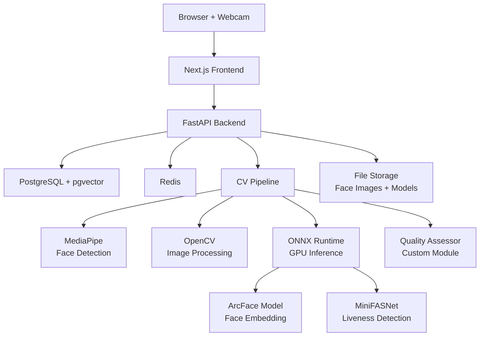

# Architecture — Facial Recognition Attendance System

> **Version:** 1.0  
> **Date:** 2026-08-13  
> **Status:** Proposed — Awaiting Approval

---

## 1. System Context

```
┌─────────────────────────────────────────────────────────────────────────┐
│                           USERS                                         │
│                                                                         │
│  ┌──────────┐    ┌──────────────┐    ┌──────────┐                      │
│  │  Admin   │    │  Instructor  │    │  Student │                      │
│  └────┬─────┘    └──────┬───────┘    └────┬─────┘                      │
│       │                 │                  │                             │
│       └────────────┬────┴──────────────────┘                            │
│                    │                                                     │
│              ┌─────▼─────┐                                              │
│              │  Browser  │ ◄── Webcam access via MediaStream API        │
│              └─────┬─────┘                                              │
└────────────────────┼────────────────────────────────────────────────────┘
                     │ HTTPS / WSS
┌────────────────────▼────────────────────────────────────────────────────┐
│                    SYSTEM BOUNDARY                                       │
│                                                                         │
│  ┌─────────────────────────────────────────────────────────────────┐    │
│  │                    FRONTEND (Next.js)                            │    │
│  │  Pages: Login | Dashboard | Registration | Attendance | Reports │    │
│  └────────────────────────────┬────────────────────────────────────┘    │
│                               │ REST API + WebSocket                    │
│  ┌────────────────────────────▼────────────────────────────────────┐    │
│  │                    BACKEND (FastAPI)                             │    │
│  │  Modules: Auth | Student | Attendance | Recognition Pipeline    │    │
│  └──────────┬──────────────────────────────┬──────────────────────┘    │
│             │                              │                            │
│  ┌──────────▼──────────┐     ┌─────────────▼─────────────┐            │
│  │   PostgreSQL        │     │    Redis                   │            │
│  │   (pgvector)        │     │    (embedding cache)       │            │
│  └─────────────────────┘     └───────────────────────────┘            │
│                                                                         │
│  ┌─────────────────────────────────────────────────────────────────┐    │
│  │               File Storage (local disk)                         │    │
│  │   /uploads/faces/  |  /models/  |  /exports/                    │    │
│  └─────────────────────────────────────────────────────────────────┘    │
│                                                                         │
└─────────────────────────────────────────────────────────────────────────┘
```

---

## 2. High-Level Architecture

### 2.1 Three-Tier Architecture

```
┌────────────────────────────────────────────────────────────────┐
│                     PRESENTATION TIER                          │
│                                                                │
│  Next.js 15 (React 19)                                         │
│  ├── Server Components (SSR pages)                             │
│  ├── Client Components (webcam, interactive UI)                │
│  ├── API Route Handlers (BFF proxy to FastAPI)                 │
│  └── WebSocket client (real-time recognition feed)             │
│                                                                │
├────────────────────────────────────────────────────────────────┤
│                     APPLICATION TIER                            │
│                                                                │
│  FastAPI (Python)                                              │
│  ├── REST API Controllers                                      │
│  │   ├── /api/v1/auth/*                                        │
│  │   ├── /api/v1/students/*                                    │
│  │   ├── /api/v1/attendance/*                                  │
│  │   ├── /api/v1/courses/*                                     │
│  │   ├── /api/v1/reports/*                                     │
│  │   └── /api/v1/admin/*                                       │
│  ├── WebSocket Endpoint                                        │
│  │   └── /ws/recognition (real-time face recognition stream)   │
│  ├── Service Layer                                             │
│  │   ├── AuthService                                           │
│  │   ├── StudentService                                        │
│  │   ├── AttendanceService                                     │
│  │   └── ReportService                                         │
│  ├── CV/ML Pipeline Engine                                     │
│  │   ├── FaceDetector                                          │
│  │   ├── FaceAligner                                           │
│  │   ├── QualityAssessor                                       │
│  │   ├── LivenessDetector                                      │
│  │   ├── FaceEmbedder                                          │
│  │   ├── FaceMatcher                                           │
│  │   └── DecisionEngine                                        │
│  └── Repository Layer (SQLAlchemy)                             │
│                                                                │
├────────────────────────────────────────────────────────────────┤
│                     DATA TIER                                  │
│                                                                │
│  PostgreSQL 16                                                 │
│  ├── Users, Students, Courses, Enrollments                     │
│  ├── Attendance Records                                        │
│  ├── Face Embeddings (pgvector)                                │
│  ├── Audit Logs                                                │
│  └── System Configuration                                      │
│                                                                │
│  Redis 7                                                       │
│  ├── Active session embedding cache                            │
│  ├── JWT token blacklist                                       │
│  ├── Rate limiting counters                                    │
│  └── Real-time recognition results                             │
│                                                                │
│  File System                                                   │
│  ├── /data/faces/ — enrolled face images (encrypted)           │
│  ├── /data/models/ — ONNX model files                          │
│  └── /data/exports/ — generated reports                        │
│                                                                │
└────────────────────────────────────────────────────────────────┘
```

---

## 3. Face Recognition Pipeline — Detailed Architecture

This is the core ML pipeline that processes each frame from the webcam.

```
                            ┌──────────────┐
                            │  Webcam Frame │
                            │  (Browser)    │
                            └──────┬───────┘
                                   │
                            Base64 / Binary via WebSocket
                                   │
                            ┌──────▼───────┐
                     ┌──────│  Frame Router │──────┐
                     │      └──────────────┘      │
                     │  (skip frames if pipeline   │
                     │   is busy — backpressure)   │
                     │                             │
                     ▼                             │
              ┌──────────────┐                     │
         ┌───▶│ FACE DETECT  │                     │
         │    │              │                     │
         │    │ MediaPipe /  │                     │
         │    │ RetinaFace   │                     │
         │    └──────┬───────┘                     │
         │           │                             │
         │    0 faces? ──── Yes ──▶ Skip frame ────┘
         │           │
         │           │ N faces detected
         │           ▼
         │    ┌──────────────┐
         │    │ FACE ALIGN   │
         │    │              │
         │    │ 5-point or   │
         │    │ 68-point     │
         │    │ landmark     │
         │    │ alignment    │
         │    └──────┬───────┘
         │           │
         │           ▼
         │    ┌──────────────┐
         │    │ FACE QUALITY │
         │    │              │
         │    │ Blur Score   │
         │    │ Exposure     │    Score < threshold?
         │    │ Pose Angles  │────── Yes ──▶ Reject + UI warning
         │    │ Occlusion    │
         │    │ Resolution   │
         │    └──────┬───────┘
         │           │ Quality OK
         │           ▼
         │    ┌──────────────┐
         │    │  LIVENESS    │
         │    │              │
         │    │ MiniFASNet   │
         │    │ + Texture    │    Spoof detected?
         │    │   Analysis   │────── Yes ──▶ Reject + alert
         │    │              │
         │    └──────┬───────┘
         │           │ Live face confirmed
         │           ▼
         │    ┌──────────────┐
         │    │ FACE EMBED   │
         │    │              │
         │    │ ArcFace /    │
         │    │ AdaFace      │
         │    │ (ONNX)       │
         │    │              │
         │    │ Output:      │
         │    │ 512-d vector │
         │    └──────┬───────┘
         │           │
         │           ▼
         │    ┌──────────────┐
         │    │   MATCHER    │
         │    │              │
         │    │ Cosine sim   │
         │    │ vs enrolled  │   No match (sim < threshold)?
         │    │ embeddings   │────── Yes ──▶ "Unknown Person"
         │    │              │
         │    └──────┬───────┘
         │           │ Match found
         │           ▼
         │    ┌──────────────┐
         │    │  DECISION    │
         │    │  ENGINE      │
         │    │              │
         │    │ Fuse:        │
         │    │ • Quality    │
         │    │ • Liveness   │
         │    │ • Similarity │
         │    │              │
         │    │ Apply rules: │
         │    │ • Cooldown   │
         │    │ • Session    │
         │    └──────┬───────┘
         │           │
         │           ▼
         │    ┌──────────────┐
         │    │  ATTENDANCE  │
         │    │  RECORD      │
         │    │              │
         │    │ Write to DB  │
         │    │ + Audit log  │
         │    │ + WS notify  │
         │    └──────────────┘
         │
         └──── Process next frame
```

### 3.1 Pipeline Performance Targets

| Stage | Target Latency | Model |
|-------|---------------|-------|
| Face Detection | < 15 ms | MediaPipe (GPU) |
| Face Alignment | < 5 ms | Landmark affine transform |
| Face Quality | < 10 ms | Lightweight CNN / heuristic |
| Liveness Detection | < 30 ms | MiniFASNet (ONNX, GPU) |
| Face Embedding | < 20 ms | ArcFace-R50 (ONNX, GPU) |
| Matching (100 faces) | < 5 ms | Cosine similarity (vectorized) |
| Decision + DB write | < 10 ms | PostgreSQL prepared statement |
| **Total pipeline** | **< 100 ms** | **~10 FPS throughput** |

### 3.2 Backpressure Strategy

When the pipeline cannot keep up with the webcam frame rate (typically 30 FPS):

1. **Frame Skipping:** Process every 3rd frame (10 FPS target)
2. **Queue Depth = 1:** If a frame arrives while the previous one is being processed, drop the old queued frame and replace it with the new one
3. **Adaptive Throttling:** If GPU utilization > 90%, temporarily increase skip interval

---

## 4. Data Model (Entity Relationships)

```
┌──────────────┐     ┌───────────────┐     ┌──────────────┐
│    User      │     │    Course     │     │   Session    │
│──────────────│     │───────────────│     │──────────────│
│ id (PK)      │     │ id (PK)       │     │ id (PK)      │
│ email        │     │ code          │     │ course_id FK │
│ password_hash│     │ name          │     │ instructor_id│
│ role         │     │ semester      │     │ date         │
│ created_at   │     │ year          │     │ start_time   │
│ is_active    │     │ instructor_id │     │ end_time     │
└──────┬───────┘     └───────┬───────┘     │ status       │
       │                     │             └──────┬───────┘
       │                     │                    │
       │  ┌──────────────────┤                    │
       │  │                  │                    │
       ▼  ▼                  ▼                    ▼
┌──────────────┐     ┌───────────────┐     ┌──────────────┐
│   Student    │     │  Enrollment   │     │  Attendance  │
│──────────────│     │───────────────│     │──────────────│
│ id (PK)      │     │ id (PK)       │     │ id (PK)      │
│ user_id FK   │     │ student_id FK │     │ student_id FK│
│ roll_number  │     │ course_id FK  │     │ session_id FK│
│ name         │     │ enrolled_at   │     │ marked_at    │
│ department   │     └───────────────┘     │ confidence   │
│ year         │                           │ quality_score│
│ section      │                           │ liveness_scr │
│ is_registered│                           │ method       │
└──────┬───────┘                           │ status       │
       │                                   │ image_hash   │
       ▼                                   └──────────────┘
┌──────────────┐
│FaceEmbedding │     ┌───────────────┐
│──────────────│     │   AuditLog    │
│ id (PK)      │     │───────────────│
│ student_id FK│     │ id (PK)       │
│ embedding    │     │ timestamp     │
│   (vector)   │     │ action        │
│ image_path   │     │ user_id       │
│ quality_score│     │ details (JSON)│
│ created_at   │     │ ip_address    │
│ is_active    │     └───────────────┘
└──────────────┘
```

---

## 5. API Design (Key Endpoints)

### 5.1 REST API

| Method | Endpoint | Description | Auth |
|--------|----------|-------------|------|
| POST | `/api/v1/auth/login` | Authenticate user | Public |
| POST | `/api/v1/auth/register` | Register new user | Admin |
| POST | `/api/v1/auth/refresh` | Refresh access token | Auth |
| GET | `/api/v1/students` | List students | Instructor+ |
| POST | `/api/v1/students` | Create student | Admin |
| GET | `/api/v1/students/{id}` | Get student details | Instructor+ |
| POST | `/api/v1/students/{id}/enroll-face` | Register face | Student/Admin |
| DELETE | `/api/v1/students/{id}/face` | Remove face data | Admin |
| POST | `/api/v1/courses` | Create course | Admin |
| GET | `/api/v1/courses/{id}/students` | List enrolled students | Instructor+ |
| POST | `/api/v1/attendance/sessions` | Create attendance session | Instructor |
| GET | `/api/v1/attendance/sessions/{id}` | Get session details | Instructor+ |
| PATCH | `/api/v1/attendance/sessions/{id}` | Update session (start/end) | Instructor |
| POST | `/api/v1/attendance/manual` | Manual attendance mark | Instructor |
| GET | `/api/v1/reports/course/{id}` | Course attendance report | Instructor+ |
| GET | `/api/v1/reports/student/{id}` | Student attendance report | Student+ |
| GET | `/api/v1/admin/audit-logs` | View audit logs | Admin |

### 5.2 WebSocket

| Endpoint | Direction | Description |
|----------|-----------|-------------|
| `/ws/recognition` | Client → Server | Send base64-encoded webcam frames |
| `/ws/recognition` | Server → Client | Return recognition results (JSON) |

**WebSocket Message Format (Server → Client):**

```json
{
  "type": "recognition_result",
  "timestamp": "2026-08-13T12:00:00Z",
  "faces": [
    {
      "bbox": [x, y, w, h],
      "student_id": "STU001",
      "name": "John Doe",
      "confidence": 0.94,
      "quality_score": 0.87,
      "liveness_score": 0.98,
      "status": "marked",
      "message": "Attendance recorded"
    }
  ],
  "pipeline_latency_ms": 78
}
```

---

## 6. Security Architecture

```
┌──────────────────────────────────────────────────────────────────┐
│                      SECURITY LAYERS                             │
│                                                                  │
│  ┌─────────────────────────────────────────────────────────┐    │
│  │  Layer 1: Transport Security                            │    │
│  │  • HTTPS (TLS 1.3) for all traffic                      │    │
│  │  • WSS for WebSocket connections                        │    │
│  └─────────────────────────────────────────────────────────┘    │
│                                                                  │
│  ┌─────────────────────────────────────────────────────────┐    │
│  │  Layer 2: Authentication                                │    │
│  │  • JWT access tokens (15-min expiry)                    │    │
│  │  • JWT refresh tokens (7-day expiry, HTTP-only cookie)  │    │
│  │  • bcrypt password hashing (cost factor 12)             │    │
│  └─────────────────────────────────────────────────────────┘    │
│                                                                  │
│  ┌─────────────────────────────────────────────────────────┐    │
│  │  Layer 3: Authorization                                 │    │
│  │  • Role-Based Access Control (Admin/Instructor/Student) │    │
│  │  • Resource-level permissions                           │    │
│  └─────────────────────────────────────────────────────────┘    │
│                                                                  │
│  ┌─────────────────────────────────────────────────────────┐    │
│  │  Layer 4: Data Protection                               │    │
│  │  • Face images encrypted at rest (AES-256)              │    │
│  │  • Embeddings stored as database vectors (not raw)      │    │
│  │  • PII fields encrypted in database                     │    │
│  │  • Consent tracking for biometric data                  │    │
│  └─────────────────────────────────────────────────────────┘    │
│                                                                  │
│  ┌─────────────────────────────────────────────────────────┐    │
│  │  Layer 5: Anti-Spoofing                                 │    │
│  │  • Liveness detection in recognition pipeline           │    │
│  │  • Rate limiting on recognition attempts                │    │
│  │  • Anomaly detection (too many failures)                │    │
│  └─────────────────────────────────────────────────────────┘    │
│                                                                  │
│  ┌─────────────────────────────────────────────────────────┐    │
│  │  Layer 6: Audit                                         │    │
│  │  • All recognition attempts logged                      │    │
│  │  • All data access logged                               │    │
│  │  • Tamper-evident audit trail                           │    │
│  └─────────────────────────────────────────────────────────┘    │
│                                                                  │
└──────────────────────────────────────────────────────────────────┘
```

---

## 7. Deployment Architecture

### 7.1 Development (Local)

```
┌─────────────────────────────────────────────────────┐
│  Developer Machine (Windows 11, GTX 1650)           │
│                                                     │
│  ┌──────────────┐  ┌──────────────┐                │
│  │ Next.js      │  │ FastAPI      │                │
│  │ (port 3000)  │  │ (port 8000)  │                │
│  └──────┬───────┘  └──────┬───────┘                │
│         │                 │                         │
│  ┌──────▼─────────────────▼───────┐                │
│  │  PostgreSQL (port 5432)        │                │
│  │  Redis (port 6379)             │                │
│  └────────────────────────────────┘                │
│                                                     │
│  Models: d:\Facial Recognition\data\models\         │
│  Uploads: d:\Facial Recognition\data\faces\         │
└─────────────────────────────────────────────────────┘
```

### 7.2 Production / Demo (Docker Compose)

```
┌─────────────────────────────────────────────────────┐
│  Docker Compose                                      │
│                                                     │
│  ┌──────────────┐                                   │
│  │    Nginx     │ ◄── Port 80/443                   │
│  │  (reverse    │                                   │
│  │   proxy)     │                                   │
│  └──────┬───────┘                                   │
│         │                                           │
│  ┌──────▼───────────────────────────────────┐       │
│  │  ┌──────────┐  ┌──────────┐             │       │
│  │  │ frontend │  │ backend  │             │       │
│  │  │ (Next.js)│  │ (FastAPI)│             │       │
│  │  └──────────┘  └──────────┘             │       │
│  │  ┌──────────┐  ┌──────────┐             │       │
│  │  │ postgres │  │  redis   │             │       │
│  │  └──────────┘  └──────────┘             │       │
│  └──────────────────────────────────────────┘       │
│                                                     │
│  Volumes:                                           │
│  ├── postgres_data                                  │
│  ├── redis_data                                     │
│  ├── face_uploads                                   │
│  └── ml_models                                      │
└─────────────────────────────────────────────────────┘
```

---

## 8. Directory Structure (Proposed)

```
d:\Facial Recognition\
├── README.md
├── .gitignore
├── docker-compose.yml
├── .env.example
│
├── backend/                          # Python FastAPI application
│   ├── pyproject.toml
│   ├── alembic.ini
│   ├── alembic/                      # Database migrations
│   │   └── versions/
│   ├── app/
│   │   ├── __init__.py
│   │   ├── main.py                   # FastAPI app entry point
│   │   ├── config.py                 # Settings & env vars
│   │   ├── dependencies.py           # Dependency injection
│   │   │
│   │   ├── api/                      # API layer
│   │   │   ├── v1/
│   │   │   │   ├── auth.py
│   │   │   │   ├── students.py
│   │   │   │   ├── courses.py
│   │   │   │   ├── attendance.py
│   │   │   │   ├── reports.py
│   │   │   │   └── admin.py
│   │   │   └── websocket/
│   │   │       └── recognition.py
│   │   │
│   │   ├── models/                   # SQLAlchemy ORM models
│   │   │   ├── user.py
│   │   │   ├── student.py
│   │   │   ├── course.py
│   │   │   ├── attendance.py
│   │   │   ├── face_embedding.py
│   │   │   └── audit_log.py
│   │   │
│   │   ├── schemas/                  # Pydantic request/response schemas
│   │   │   ├── auth.py
│   │   │   ├── student.py
│   │   │   ├── attendance.py
│   │   │   └── report.py
│   │   │
│   │   ├── services/                 # Business logic
│   │   │   ├── auth_service.py
│   │   │   ├── student_service.py
│   │   │   ├── attendance_service.py
│   │   │   └── report_service.py
│   │   │
│   │   ├── cv/                       # Computer Vision pipeline
│   │   │   ├── __init__.py
│   │   │   ├── pipeline.py           # Orchestrator
│   │   │   ├── face_detector.py
│   │   │   ├── face_aligner.py
│   │   │   ├── quality_assessor.py
│   │   │   ├── liveness_detector.py
│   │   │   ├── face_embedder.py
│   │   │   ├── face_matcher.py
│   │   │   └── decision_engine.py
│   │   │
│   │   ├── core/                     # Cross-cutting concerns
│   │   │   ├── security.py
│   │   │   ├── database.py
│   │   │   ├── redis.py
│   │   │   └── logging.py
│   │   │
│   │   └── utils/                    # Utilities
│   │       ├── image_utils.py
│   │       └── crypto.py
│   │
│   └── tests/
│       ├── conftest.py
│       ├── test_api/
│       ├── test_services/
│       └── test_cv/
│
├── frontend/                          # Next.js application
│   ├── package.json
│   ├── next.config.js
│   ├── tailwind.config.js
│   ├── tsconfig.json
│   ├── src/
│   │   ├── app/                      # App Router pages
│   │   │   ├── layout.tsx
│   │   │   ├── page.tsx              # Landing/login
│   │   │   ├── dashboard/
│   │   │   ├── students/
│   │   │   ├── attendance/
│   │   │   ├── registration/
│   │   │   └── reports/
│   │   ├── components/               # Reusable UI components
│   │   │   ├── ui/                   # shadcn components
│   │   │   ├── webcam/
│   │   │   ├── charts/
│   │   │   └── layout/
│   │   ├── hooks/                    # Custom React hooks
│   │   ├── lib/                      # Utilities, API client
│   │   ├── stores/                   # State management
│   │   └── types/                    # TypeScript types
│   └── public/
│
├── data/                              # Runtime data (gitignored)
│   ├── models/                       # ONNX model files
│   ├── faces/                        # Enrolled face images
│   └── exports/                      # Generated reports
│
├── research/                          # Research & experimentation
│   ├── notebooks/                    # Jupyter notebooks
│   ├── experiments/                  # Experiment configs & results
│   ├── benchmarks/                   # Benchmark scripts
│   └── paper/                        # LaTeX research paper
│
├── docs/                              # Documentation
│   ├── project_plan.md
│   ├── architecture.md
│   ├── development_roadmap.md
│   ├── srs.md
│   └── project_report.md
│
└── scripts/                           # Utility scripts
    ├── setup_dev.ps1                 # Dev environment setup
    ├── download_models.py            # Download pre-trained models
    └── seed_db.py                    # Seed database with test data
```

---

## 9. Technology Dependency Graph



---

*This architecture document will be refined as implementation progresses and technical decisions are finalized.*
